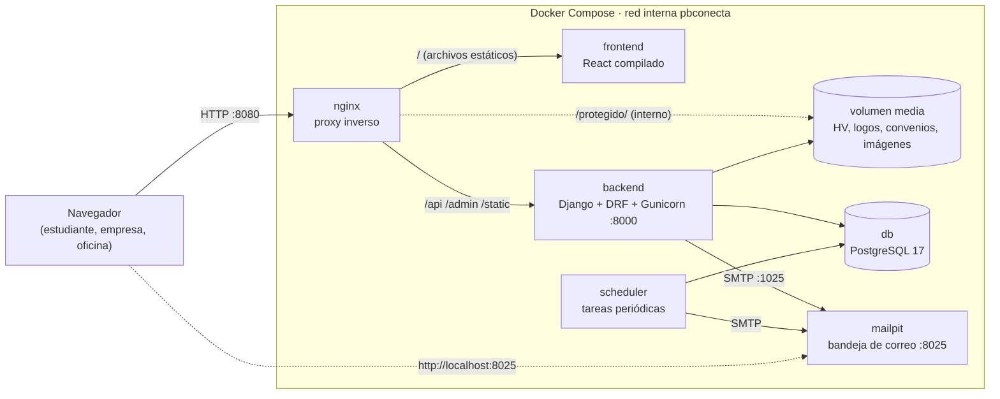

# PB Conecta — Arquitectura del sistema

| | |
|---|---|
| **Versión** | 0.1 |
| **Fecha** | 16 de octubre de 2026 |
| **Basado en** | [01-requerimientos.md](01-requerimientos.md) v0.4 |

---

## 1. Vista general

PB Conecta es una **aplicación web de tres capas**:

- un frontend en React que corre en el navegador (SPA);
- una API REST en Django;
- una base de datos PostgreSQL.

Todo corre en contenedores Docker orquestados con Docker Compose, y Nginx es el único punto de entrada.



**Flujo de una petición:** el navegador carga la SPA desde Nginx. La SPA llama a `/api/v1/...` con un token JWT. Nginx reenvía esas llamadas a Gunicorn, Django valida el token, el rol y la pertenencia del recurso, consulta PostgreSQL y responde en JSON.

---

## 2. Contenedores

| Servicio | Imagen base | Puerto expuesto | Responsabilidad | Volúmenes |
|---|---|---|---|---|
| `nginx` | `nginx:1.27-alpine` | **8080** (en el equipo) | Sirve el frontend compilado, reenvía `/api` y `/admin` al backend y entrega los archivos protegidos con `X-Accel-Redirect`. | `media` (solo lectura), `static` |
| `frontend` | `node:22-alpine` (compilación) | interno 5173 | En desarrollo corre Vite con recarga en caliente detrás de Nginx. En modo demo se compila y Nginx sirve el resultado. | código fuente (desarrollo) |
| `backend` | `python:3.12-slim` | interno 8000 | API REST, panel de administración de Django, reglas de negocio y envío de correos. | `media`, `static` |
| `scheduler` | misma imagen que `backend` | — | Ejecuta comandos de Django periódicamente: cierre de convocatorias, vencimiento de convenios y alertas. | — |
| `db` | `postgres:17-alpine` | 5433 (en el equipo) | Base de datos. Usa las extensiones `unaccent` y `pg_trgm`. | `pg_data` |
| `mailpit` | `axllent/mailpit` | **8025** (bandeja web) | Recibe todos los correos del sistema sin enviarlos a internet. | — |

### 2.1 Modos de ejecución

| Modo | Comando | Uso |
|---|---|---|
| **Desarrollo** | `docker compose up` | Todo entra por `http://localhost:8080`. Backend con `runserver` y frontend con Vite, ambos con recarga automática. La base de datos se puede inspeccionar con DBeaver o pgAdmin en el puerto 5433. |
| **Demo** | `docker compose -f docker-compose.yml -f docker-compose.demo.yml up --build` | Frontend compilado servido por Nginx en `:8080` y backend con Gunicorn. Es el modo para la sustentación. |

Al arrancar, el backend ejecuta `migrate` y, si la base de datos está vacía, `cargar_demo`, que crea catálogos, empresas, convocatorias, publicaciones y un usuario por rol (RNF-15).

---

## 3. Backend (Django)

### 3.1 Organización por módulos (apps de Django)

| App | Módulos del requerimiento | Modelos principales |
|---|---|---|
| `cuentas` | M1 | Usuario, ConsentimientoDatos |
| `catalogos` | M7 (RF-68) | Facultad, Programa, Habilidad, Sector, Ciudad, PeriodoAcademico, Parametro |
| `estudiantes` | M2, M7 (habilitación y asesoría) | PerfilEstudiante, EstudianteHabilidad, Idioma, Experiencia, Proyecto, Certificacion, Enlace, Habilitacion, NotaAsesoria |
| `empresas` | M3 | Empresa, UsuarioEmpresa, Convenio, EmpresaSeguida |
| `convocatorias` | M4, M5 | Convocatoria, ConvocatoriaGuardada |
| `postulaciones` | M6, M7 (legalización) | Postulacion, HistorialEstado, Entrevista, EntradaSeguimiento, VerificacionRequisitos, Practica |
| `muro` | M10 | Publicacion, Comentario, Reaccion, PublicacionGuardada |
| `notificaciones` | M9 | Notificacion |
| `reportes` | M8 | (sin modelos: consultas agregadas y exportación a CSV) |

### 3.2 Capas dentro de cada app

```
app/
├── models.py        # Tablas y restricciones de base de datos
├── serializers.py   # Validación de entrada y forma de las respuestas JSON
├── views.py         # Endpoints (ViewSets de DRF): delgados, sin lógica de negocio
├── permissions.py   # Reglas de acceso por rol y por objeto
├── services.py      # Lógica de negocio y transiciones de estado (aquí viven las RN)
├── selectors.py     # Consultas de lectura complejas (búsqueda, afinidad, indicadores)
├── admin.py         # Panel de administración de Django para el superadmin
└── tests/           # Pruebas de reglas de negocio y permisos
```

**Regla del proyecto:** ninguna vista cambia el estado de un objeto directamente. Siempre llama a un servicio, por ejemplo `postulaciones.services.cambiar_estado(postulacion, nuevo_estado, usuario, comentario)`. Así cada regla de negocio se implementa una sola vez y se prueba en un solo lugar.

### 3.3 Máquinas de estado

Cada objeto con ciclo de vida tiene un diccionario de transiciones permitidas y quién puede ejecutarlas. Con él se cumple **RN-13**. Ejemplo para la postulación:

```python
TRANSICIONES = {
    "POSTULADO":       {"EN_REVISION": {EMPRESA, OFICINA}, "RETIRADO": {ESTUDIANTE}},
    "EN_REVISION":     {"PRESELECCIONADO": {EMPRESA, OFICINA}, "NO_SELECCIONADO": {EMPRESA, OFICINA}},
    "PRESELECCIONADO": {"ENTREVISTA": {EMPRESA}, "NO_SELECCIONADO": {EMPRESA, OFICINA}},
    "ENTREVISTA":      {"SELECCIONADO": {EMPRESA}, "NO_SELECCIONADO": {EMPRESA, OFICINA}},
    "SELECCIONADO":    {"LEGALIZADO": {OFICINA}, "RETIRADO": {ESTUDIANTE}},
}
```

`cambiar_estado()` hace siempre lo mismo y en este orden, dentro de una transacción:

1. Valida que la transición exista y que el rol tenga permiso.
2. Aplica las validaciones propias del estado, como el motivo obligatorio (RN-11) o la verificación previa a la legalización (RN-07).
3. Guarda el nuevo estado.
4. Escribe una fila en `HistorialEstado` (RN-12).
5. Dispara la notificación correspondiente.

Lo mismo se aplica a Empresa, Convocatoria, Practica y la habilitación del estudiante.

### 3.4 Autenticación y autorización

- **Modelo de usuario propio**: el correo es el identificador y el campo `rol` toma uno de estos valores: `ESTUDIANTE`, `EMPRESA`, `OFICINA` o `SUPERADMIN`.
- **JWT** con `djangorestframework-simplejwt`. El token de acceso dura 30 min y el de renovación 7 días, con rotación (RNF-04). El frontend renueva el token automáticamente cuando recibe un error 401.
- **Verificación de correo**: al registrarse, el usuario recibe un enlace firmado con `django.core.signing` y la cuenta queda inactiva hasta que lo abre.
- **Límite de intentos**: el inicio de sesión está limitado a 5 intentos por minuto por IP con el *throttling* de DRF (RNF-07).
- **Autorización en dos niveles**:
  1. Por rol: clases `EsEstudiante`, `EsEmpresaAliada`, `EsOficina` y `EsSuperadmin`.
  2. Por objeto: los *querysets* se filtran por el usuario. Por ejemplo, una empresa solo obtiene `Postulacion.objects.filter(convocatoria__empresa=mi_empresa)`. Así, un recurso ajeno responde **404** y no revela que existe (RNF-05).

**Matriz de acceso resumida:**

| Recurso | Estudiante | Empresa aliada | Oficina | Superadmin |
|---|---|---|---|---|
| Su propio perfil | Leer y editar | Leer y editar (empresa) | Leer y editar | Todo |
| Perfil de un estudiante | — | Solo sus postulantes o los "Abiertos a oportunidades" (sin documento) | Leer y anotar | Todo |
| Hoja de vida | La suya | Solo de sus postulantes | Todas | Todo |
| Convocatorias | Leer las publicadas | CRUD de las suyas | CRUD de todas, aprobar o devolver | Todo |
| Postulaciones | Las suyas: crear y retirar | Las de sus convocatorias: cambiar estado | Todas: intervenir, verificar y legalizar | Todo |
| Bitácora de seguimiento | Mensajes de sus postulaciones | Mensajes de sus postulaciones | Todo, incluidas las notas internas | Todo |
| Habilitación de estudiantes | Ver la suya | — | Habilitar y deshabilitar | Todo |
| Muro | Leer, reaccionar y comentar | + publicar noticias y eventos | + publicar todo y moderar | Todo |
| Indicadores | — | Resumen propio | Tablero completo y exportación | Todo |
| Catálogos | Leer | Leer | Leer | CRUD |

### 3.5 Archivos protegidos

Las hojas de vida, los convenios y los soportes de legalización **no se publican** en una URL pública (RNF-06):

1. El frontend pide `GET /api/v1/postulaciones/{id}/hoja-vida/`.
2. Django verifica que el usuario tenga permiso sobre esa postulación.
3. Django responde con la cabecera `X-Accel-Redirect: /protegido/hv/<nombre-aleatorio>.pdf`.
4. Nginx entrega el archivo desde una ubicación `internal`, que no se puede abrir directamente desde el navegador.

Los logos y las imágenes del muro sí son públicos y se sirven en `/media/publico/`.

**Validación al subir archivos:** se comprueban la extensión, el tipo MIME real (con `python-magic`) y un tamaño máximo de 5 MB, y el archivo se guarda con un nombre UUID.

### 3.6 Búsqueda de convocatorias

La búsqueda se hace con la **búsqueda de texto completo de PostgreSQL**, sin otro motor:

- `Convocatoria.search_vector` (tipo `tsvector`) combina el título (peso A), la descripción y las funciones (peso B) y el nombre de la empresa (peso C), con configuración `spanish` y `unaccent` para ignorar tildes.
- Un **índice GIN** sobre `search_vector` hace la búsqueda rápida.
- La columna se actualiza en el servicio cada vez que se guarda una convocatoria.
- Los filtros (programa, modalidad, ciudad y demás) se implementan con `django-filter` sobre columnas indexadas.

### 3.7 Índice de afinidad (RF-42, RF-53)

Es un cálculo sencillo y explicable de **0 a 100**, que se recalcula en las recomendaciones y se guarda en la postulación en el momento de postularse:

| Componente | Puntos | Cómo se calcula |
|---|---|---|
| Programa afín | 50 | El programa del estudiante está entre los programas afines de la convocatoria. Si no lo está, la afinidad es 0. |
| Habilidades | 0–35 | 35 × (habilidades requeridas que el estudiante tiene ÷ habilidades requeridas). Si la convocatoria no pide habilidades, suma 35. |
| Modalidad | 0–10 | 10 si coincide con la modalidad preferida o si el estudiante elige "híbrida". |
| Disponibilidad | 0–5 | 5 si la fecha disponible del estudiante es igual o anterior a la fecha de inicio de la convocatoria. |

La interfaz muestra el porcentaje y el desglose, por ejemplo: "Tienes 3 de 4 habilidades requeridas".

### 3.8 Tareas programadas (contenedor `scheduler`)

Es un bucle sencillo que ejecuta estos comandos de Django. No se usan Celery ni Redis en el prototipo.

| Comando | Frecuencia | Qué hace | Requerimiento |
|---|---|---|---|
| `cerrar_convocatorias` | cada 15 min | Cierra las convocatorias con fecha de cierre vencida y las que tienen todos sus cupos legalizados | RF-34, RN-09 |
| `revisar_convenios` | diaria | Avisa de convenios que vencen en 30 días y pasa a *Convenio vencido* las empresas cuyo convenio terminó | RF-26, RN-02 |
| `generar_alertas` | diaria | Avisa a la oficina el resumen de alertas del día (una vez por día). Las alertas en sí se calculan en el momento en `/oficina/alertas` | RF-66 |
| `iniciar_practicas` | diaria | Pasa las prácticas de *Legalizada* a *En curso* al llegar la fecha de inicio | Ciclo de la Práctica |

Todos los comandos son **idempotentes**: ejecutarlos dos veces no causa efectos duplicados. También se pueden lanzar a mano durante la demo.

### 3.9 Notificaciones

Hay una sola función de servicio:

```python
notificar(usuario, tipo, titulo, mensaje, url, correo=True)
```

1. Crea una fila en `Notificacion`, que aparece en la campana (RF-90).
2. Si `correo=True`, envía un correo con plantilla HTML por SMTP a Mailpit (RF-91).

En el prototipo el envío es **síncrono**, porque el volumen es bajo. Si la plataforma crece, esta función es el único punto que habría que mover a una cola.

### 3.10 Muro de publicaciones

- Cuando una convocatoria pasa a *Publicada*, el servicio crea en la misma transacción una `Publicacion` de tipo `CONVOCATORIA` enlazada a ella (RF-35). Si la convocatoria se cierra, la publicación sigue en el muro marcada como "Cerrada".
- El *feed* se pagina por cursor, ordenado por `creada_en` descendente, con 20 elementos por página (RNF-09).
- Para un estudiante, el orden pone primero las publicaciones dirigidas a su programa (RF-100).

---

## 4. Frontend (React)

### 4.1 Tecnologías

| Necesidad | Librería |
|---|---|
| Base | React 19 + Vite + TypeScript |
| Rutas | React Router |
| Datos del servidor y caché | TanStack Query |
| Peticiones HTTP | Axios, con un interceptor que agrega el JWT y lo renueva al recibir 401 |
| Componentes y tema | MUI, con la paleta institucional en un solo archivo `theme.ts` (RNF-12) |
| Formularios | React Hook Form + Zod |
| Fechas | Day.js con localización `es` (RNF-17) |

### 4.2 Estructura

```
frontend/src/
├── api/              # Cliente Axios y funciones por recurso
├── auth/             # Contexto de sesión, rutas protegidas por rol
├── layouts/          # Plantillas por rol (menú lateral, barra superior, campana)
├── features/
│   ├── muro/
│   ├── convocatorias/
│   ├── postulaciones/
│   ├── perfil-estudiante/
│   ├── empresas/
│   ├── oficina/      # Aprobaciones, habilitación, legalización, alertas
│   └── indicadores/
├── components/       # Componentes compartidos (EstadoChip, Afinidad, Timeline…)
└── theme.ts
```

### 4.3 Mapa de pantallas por rol

| Rol | Pantallas |
|---|---|
| **Público** | Inicio · Directorio de empresas · Iniciar sesión · Registro de estudiante · Solicitud de empresa · Recuperar contraseña |
| **Estudiante** | Muro · Convocatorias (Mi programa / Ver todas / Recomendadas) · Detalle de convocatoria · Mis postulaciones (con línea de tiempo y bitácora) · Mi perfil (con estado de habilitación) · Empresas · Guardados · Notificaciones |
| **Empresa** | Muro · Mis convocatorias · Nueva convocatoria · Postulantes por convocatoria (tablero por estado) · Detalle de postulación (perfil, HV, bitácora, entrevista) · Buscar talento · Perfil de la empresa · Resumen |
| **Oficina** | Tablero de indicadores · Alertas · Estudiantes (habilitar o deshabilitar, notas) · Empresas y convenios · Convocatorias por revisar · Postulaciones (vista global) · Legalizaciones · Prácticas · Muro (publicar y moderar) · Exportaciones |
| **Superadmin** | Panel de administración de Django (`/admin`) para catálogos, parámetros y usuarios |

---

## 5. API REST

### 5.1 Convenciones

- Prefijo **`/api/v1/`**. Todas las respuestas son JSON y los campos usan `snake_case`.
- Los listados son paginados, con 20 elementos por defecto, y devuelven `{count, next, previous, results}`.
- Las acciones de cambio de estado son endpoints explícitos con `POST`, por ejemplo `/convocatorias/{id}/aprobar/`, y no se hacen con `PATCH` sobre el campo `estado`.
- Cada convocatoria trae el campo `acciones` con lo que el usuario actual puede hacer sobre ella. El frontend solo muestra esos botones, y el backend vuelve a validar cada acción.
- Los errores siguen el formato estándar de DRF, con mensajes en español.
- La documentación se genera automáticamente en **`/api/docs`** (Swagger) y **`/api/schema`** (OpenAPI) (RNF-13).

### 5.2 Mapa de recursos

| Grupo | Endpoints principales |
|---|---|
| `auth/` | `registro/estudiante` · `registro/empresa` · `verificar-correo` · `token` · `token/refrescar` · `recuperar` · `restablecer` · `cambiar-clave` · `yo` |
| `catalogos/` | `programas` · `habilidades` · `sectores` · `ciudades` · `periodos` |
| `estudiantes/` | `yo` (GET/PATCH) · `yo/habilidades` (PUT) · `yo/hoja-vida` (POST/GET/DELETE) · `yo/idiomas` · `yo/experiencias` · `yo/proyectos` · `yo/certificaciones` · `yo/enlaces` |
| `talento/` | `/` (empresas aliadas: habilitados «Abiertos a oportunidades», sin datos de contacto; filtros `?programa=&habilidades=&modalidad=&q=`) · `{id}` · `{id}/invitar` |
| `empresas/` | `/` (directorio público) · `{id}` (página pública) · `{id}/seguir` · `yo` (perfil propio) · `yo/logo` · `yo/resumen` |
| `convocatorias/` | `/` (cada rol ve lo suyo; filtros `?estado=&q=&empresa=&modalidad=&tipo_vinculacion=&ciudad=&con_apoyo=1`; estudiante: `mi_programa=1`, `guardadas=1`) · `resumen` · `recomendadas` · `{id}` (para el estudiante incluye `para_estudiante`: afinidad, su postulación y si puede postularse) · `{id}/guardar` · `{id}/enviar-revision` · `{id}/aprobar` · `{id}/devolver` · `{id}/cerrar` · `{id}/duplicar` |
| `postulaciones/` | `/` (cada rol ve las suyas; `?convocatoria=&estado=&q=&orden=afinidad`) · `resumen` · `{id}` (incluye historial, entrevistas, bitácora, perfil profesional y `acciones`) · `{id}/cambiar-estado` · `{id}/retirar` · `{id}/entrevistas` · `{id}/seguimiento` · `{id}/hoja-vida` · `{id}/verificar` · `{id}/legalizar` (solo oficina) |
| `practicas/` | `/` (cada rol ve las suyas) · `resumen` · `{id}` · `{id}/finalizar` · `{id}/cancelar` (solo oficina) · `{id}/documento` |
| `oficina/` | `empresas` (lista, crear) · `empresas/resumen` · `empresas/{id}` · `{id}/aprobar` · `{id}/rechazar` · `{id}/suspender` · `{id}/reactivar` · `{id}/convenios` · `{id}/convenios/{c}/documento` · `estudiantes` · `estudiantes/resumen` · `estudiantes/{id}/habilitar` · `deshabilitar` · `estudiantes/habilitar-varios` · `estudiantes/{id}/notas` · `alertas` · `indicadores` (`?periodo=&programa=`) · `exportar/{estudiantes|postulaciones|practicas|convocatorias|empresas}.csv` |
| `muro/` | `publicaciones` (`?tipo=&para_mi=1&guardadas=1&estado=OCULTA&q=`) · `publicaciones/permisos` · `{id}` · `{id}/reaccionar` · `{id}/guardar` · `{id}/comentarios` · `{id}/comentarios/{c}/ocultar` · `{id}/ocultar` · `{id}/mostrar` |
| `notificaciones/` | `/` · `{id}/leer` · `leer-todas` · `no-leidas/conteo` |

El detalle de cada endpoint (cuerpo de la petición, respuestas y errores) está en Swagger: `http://localhost:8080/api/docs/`.

---

## 6. Estructura del repositorio

```
pb-conecta/
├── docker-compose.yml          # Servicios base (desarrollo)
├── docker-compose.demo.yml     # Sobrescritura para el modo demo
├── .env.example                # Variables de entorno documentadas
├── README.md                   # Cómo levantar el proyecto en 3 pasos
├── docs/                       # Requerimientos, arquitectura, modelo de datos
├── nginx/
│   └── default.conf
├── backend/
│   ├── Dockerfile
│   ├── requirements.txt
│   ├── manage.py
│   ├── config/                 # settings, urls, wsgi
│   ├── apps/
│   │   ├── cuentas/  catalogos/  estudiantes/  empresas/
│   │   ├── convocatorias/  postulaciones/  muro/
│   │   └── notificaciones/  reportes/
│   ├── templates/correos/      # Plantillas HTML de los correos
│   └── fixtures/               # Datos de demostración
├── frontend/
│   ├── Dockerfile
│   ├── package.json
│   └── src/
└── scripts/
    ├── backup.sh               # pg_dump (RNF-16)
    └── restore.sh
```

---

## 7. Variables de entorno (`.env`)

| Variable | Ejemplo | Para qué |
|---|---|---|
| `POSTGRES_DB` / `POSTGRES_USER` / `POSTGRES_PASSWORD` | `pbconecta` / `pbconecta` / *(generada)* | Credenciales de la base de datos |
| `DJANGO_SECRET_KEY` | *(generada)* | Firma de sesiones y tokens |
| `DJANGO_DEBUG` | `1` en desarrollo, `0` en demo | Modo de depuración |
| `DJANGO_ALLOWED_HOSTS` | `localhost,127.0.0.1` | Hosts permitidos |
| `DOMINIO_INSTITUCIONAL` | `pascualbravo.edu.co` | Dominio exigido a estudiantes y oficina (RN-01) |
| `FRONTEND_URL` | `http://localhost:8080` | Enlaces en los correos |
| `EMAIL_HOST` / `EMAIL_PORT` | `mailpit` / `1025` | Servidor SMTP |
| `JWT_ACCESS_MIN` / `JWT_REFRESH_DIAS` | `30` / `7` | Duración de los tokens |
| `MAX_ARCHIVO_MB` | `5` | Tamaño máximo de archivos |
| `CARGAR_DEMO` | `1` | Cargar los datos de demostración si la base de datos está vacía |

Los parámetros de negocio que la oficina podría querer ajustar (días de las alertas de RF-66) **no van en el `.env`**. Se guardan en la tabla `Parametro` y se editan desde el panel de administración.

---

## 8. Decisiones de arquitectura

| # | Decisión | Alternativa descartada | Motivo |
|---|---|---|---|
| A1 | **Monolito modular** en Django (una API, varias apps) | Microservicios | El equipo es de 5 personas, el alcance es de prototipo y se necesita una sola base de datos. Los microservicios agregarían complejidad sin beneficio. |
| A2 | **SPA en React + API REST** separadas | Plantillas de Django | Lo pide el proyecto y deja la API lista para una futura app móvil. |
| A3 | **JWT** en lugar de sesiones con cookie | Sesiones de Django | Es el estándar para una SPA que consume una API y simplifica CORS en desarrollo. |
| A4 | **Búsqueda de texto completo de PostgreSQL** | Elasticsearch o Meilisearch | Evita otro servicio que mantener y es suficiente para el volumen de una universidad. |
| A5 | **Tareas programadas con un bucle de comandos** | Celery + Redis | Las tareas son pocas, diarias o cada 15 minutos. Se puede migrar a Celery sin cambiar la lógica, porque ya está en servicios. |
| A6 | **Envío de correo síncrono** a Mailpit | Cola de mensajes | El volumen del prototipo es bajo y todo el envío pasa por una sola función, fácil de cambiar después. |
| A7 | **Archivos en un volumen local** servidos con `X-Accel-Redirect` | MinIO o S3 | Es gratuito, simple y mantiene la protección de las hojas de vida. MinIO queda como opción si se despliega en varios servidores. |
| A8 | **Lógica de negocio en `services.py`** y vistas delgadas | Lógica en vistas o en señales | Las reglas quedan explícitas, en un solo lugar y fáciles de probar (RNF-14). |
