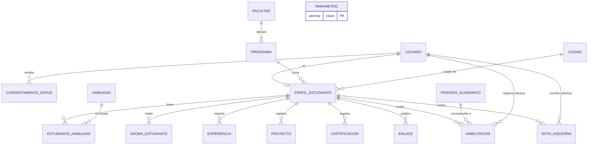
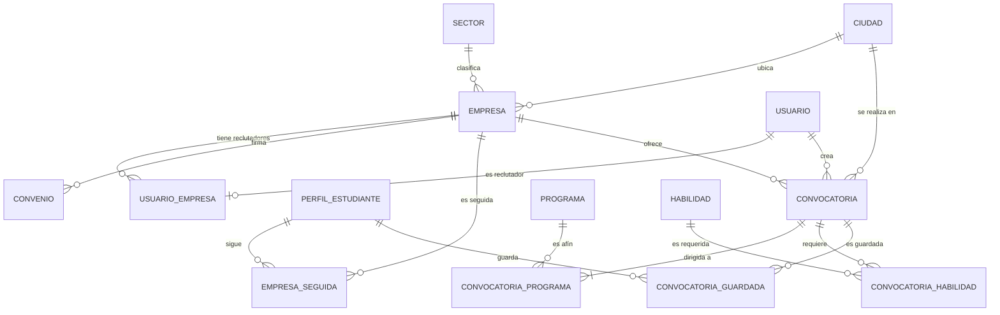
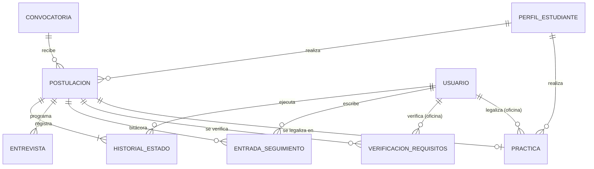
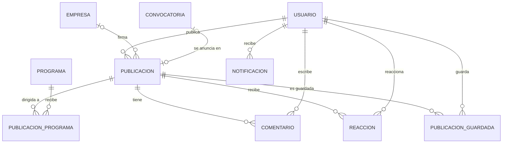

# PB Conecta — Modelo entidad-relación

| | |
|---|---|
| **Versión** | 0.1 |
| **Fecha** | 16 de octubre de 2026 |
| **Motor** | PostgreSQL 17 |
| **Basado en** | [01-requerimientos.md](01-requerimientos.md) v0.4 · [02-arquitectura.md](02-arquitectura.md) v0.1 |

---

## 1. Convenciones

- **Nombres** en español, en `snake_case` y en singular. Cada modelo de Django define `db_table` explícitamente para que las tablas no lleven el prefijo de la app, por ejemplo `postulacion` y no `postulaciones_postulacion`.
- **Llaves primarias:** `id bigint` autoincremental en todas las tablas. En las tablas puente, las columnas marcadas como `PK` en el diccionario se implementan como `id` + una restricción **UNIQUE** sobre el par, que es como Django maneja las relaciones muchos a muchos. El efecto es el mismo: no se puede repetir el par.
- **Estados y listas cerradas** (enums): se guardan como `varchar(25)` con una restricción `CHECK` sobre los valores permitidos. En Django son `TextChoices` + `CheckConstraint`. Agregar un valor no requiere crear tipos en PostgreSQL.
- **Fechas:** `timestamptz` para eventos y `date` para fechas de calendario. La zona de presentación es America/Bogota.
- **Auditoría:** casi todas las tablas tienen `creado_en` (`timestamptz`, `DEFAULT now()`). Las tablas editables tienen además `actualizado_en`.
- **Archivos:** se guarda la ruta relativa dentro del volumen `media` (`varchar(255)`), nunca el archivo dentro de la base de datos.
- **Tablas de solo inserción:** `historial_estado`, `entrada_seguimiento`, `habilitacion` y `verificacion_requisitos` no se editan ni se borran (RN-12). El servicio solo inserta en ellas y el admin de Django las muestra en modo lectura.

**Total: 38 tablas** en 8 dominios (una app de Django por dominio).

> **No modelado en esta versión:** las preguntas de filtro de las convocatorias (RF-36, prioridad Opcional). Si se incluyen, se agregan las tablas `pregunta_filtro` y `respuesta_filtro` sin afectar las demás.

---

## 2. Diagramas entidad-relación

Notación: `||` = exactamente uno · `o|` = cero o uno · `|{` = uno o muchos · `o{` = cero o muchos.

### 2.1 Cuentas, catálogos y estudiantes

### 2.2 Empresas y convocatorias

### 2.3 Postulaciones y prácticas

### 2.4 Muro y notificaciones

---

## 3. Diccionario de datos

`PK` llave primaria · `FK` llave foránea · `UQ` único · `NN` no nulo · `CK` restricción CHECK. Los campos sin `NN` aceptan nulos.

### 3.1 Cuentas — app `cuentas`

#### `usuario`
| Campo | Tipo | Restricciones | Descripción |
|---|---|---|---|
| id | bigint | PK | |
| email | varchar(254) | UQ (sin distinguir mayúsculas), NN | Identificador de inicio de sesión |
| password | varchar(128) | NN | Hash PBKDF2 o Argon2 (RNF-03) |
| nombres | varchar(100) | NN | |
| apellidos | varchar(100) | NN | |
| telefono | varchar(20) | | Lo ve la empresa en sus postulaciones (RF-58) |
| foto | varchar(255) | | Ruta en `media/publico/` |
| rol | varchar(25) | NN, CK ∈ {ESTUDIANTE, EMPRESA, OFICINA, SUPERADMIN} | |
| is_active | boolean | NN, DEFAULT false | Se activa al verificar el correo |
| email_verificado_en | timestamptz | | |
| last_login | timestamptz | | |
| creado_en | timestamptz | NN | |

> RN-01: en el servicio de registro se valida que `email` termine en `@{DOMINIO_INSTITUCIONAL}` cuando el rol es ESTUDIANTE u OFICINA. No es un CHECK de base de datos porque el dominio es configurable.

#### `consentimiento_datos`
| Campo | Tipo | Restricciones | Descripción |
|---|---|---|---|
| id | bigint | PK | |
| usuario_id | bigint | FK → usuario, NN | |
| version_politica | varchar(20) | NN | Por ejemplo "2026-10" |
| aceptado_en | timestamptz | NN | |
| ip | inet | | |

### 3.2 Catálogos — app `catalogos`

#### `facultad`
| Campo | Tipo | Restricciones |
|---|---|---|
| id | bigint | PK |
| nombre | varchar(150) | UQ, NN |

#### `programa`
| Campo | Tipo | Restricciones | Descripción |
|---|---|---|---|
| id | bigint | PK | |
| facultad_id | bigint | FK → facultad, NN | |
| nombre | varchar(150) | NN | "Tecnología en Desarrollo de Software" |
| nivel | varchar(25) | NN, CK ∈ {TECNICO, TECNOLOGICO, PROFESIONAL} | |
| activo | boolean | NN, DEFAULT true | |
| | | UQ (nombre, nivel) | |

#### `habilidad`
| Campo | Tipo | Restricciones | Descripción |
|---|---|---|---|
| id | bigint | PK | |
| nombre | varchar(80) | NN, UQ sobre `lower(nombre)` | "Python", "Trabajo en equipo" |
| tipo | varchar(25) | NN, CK ∈ {TECNICA, BLANDA} | |
| creada_por_usuario | boolean | NN, DEFAULT false | True si la agregó un estudiante (RF-11). El superadmin puede depurarla. |

#### `sector`
| Campo | Tipo | Restricciones |
|---|---|---|
| id | bigint | PK |
| nombre | varchar(100) | UQ, NN |

#### `ciudad`
| Campo | Tipo | Restricciones |
|---|---|---|
| id | bigint | PK |
| nombre | varchar(100) | NN |
| departamento | varchar(100) | NN |
| | | UQ (nombre, departamento) |

#### `periodo_academico`
| Campo | Tipo | Restricciones | Descripción |
|---|---|---|---|
| id | bigint | PK | |
| codigo | varchar(10) | UQ, NN | "2026-2" |
| fecha_inicio | date | NN | |
| fecha_fin | date | NN, CK fecha_fin > fecha_inicio | |
| vigente | boolean | NN, DEFAULT false | **Índice único parcial** `WHERE vigente`: solo un periodo vigente a la vez |

#### `parametro`
| Campo | Tipo | Restricciones | Descripción |
|---|---|---|---|
| clave | varchar(60) | PK | `dias_sin_postular`, `dias_sin_respuesta`, `dias_sin_ubicar`, `dias_aviso_convenio` |
| valor | varchar(255) | NN | |
| descripcion | text | | |

### 3.3 Estudiantes — app `estudiantes`

#### `perfil_estudiante`
| Campo | Tipo | Restricciones | Descripción |
|---|---|---|---|
| id | bigint | PK | |
| usuario_id | bigint | FK → usuario, UQ, NN | Relación 1 a 1 |
| programa_id | bigint | FK → programa, NN | |
| documento | varchar(20) | UQ | Dato sensible: nunca se envía a empresas (RF-16) |
| semestre | smallint | CK entre 1 y 12 | |
| ciudad_id | bigint | FK → ciudad | |
| titular | varchar(150) | | "Estudiante de Software · React y Django" |
| acerca_de | text | | |
| hoja_vida | varchar(255) | | Ruta en `media/protegido/hv/` |
| fecha_disponible | date | | RF-14 |
| jornada | varchar(25) | CK ∈ {COMPLETA, MEDIA, FLEXIBLE} | |
| modalidad_preferida | varchar(25) | CK ∈ {PRESENCIAL, REMOTA, HIBRIDA} | |
| abierto_oportunidades | boolean | NN, DEFAULT false | RF-17 |
| estado | varchar(25) | NN, DEFAULT 'NO_HABILITADO', CK ∈ {NO_HABILITADO, HABILITADO, UBICADO, EN_PRACTICA, PRACTICA_FINALIZADA} | Lo cambian solo los servicios. "En búsqueda" se calcula: HABILITADO con postulaciones activas. |
| actualizado_en | timestamptz | NN | |

#### `estudiante_habilidad`
| Campo | Tipo | Restricciones |
|---|---|---|
| estudiante_id | bigint | PK, FK → perfil_estudiante |
| habilidad_id | bigint | PK, FK → habilidad |
| nivel | varchar(25) | NN, CK ∈ {BASICO, INTERMEDIO, AVANZADO} |

#### `idioma_estudiante`
| Campo | Tipo | Restricciones |
|---|---|---|
| id | bigint | PK |
| estudiante_id | bigint | FK → perfil_estudiante, NN |
| idioma | varchar(50) | NN |
| nivel | varchar(10) | NN, CK ∈ {A1, A2, B1, B2, C1, C2, NATIVO} |
| | | UQ (estudiante_id, idioma) |

#### `experiencia`
| Campo | Tipo | Restricciones |
|---|---|---|
| id | bigint | PK |
| estudiante_id | bigint | FK → perfil_estudiante, NN |
| cargo | varchar(120) | NN |
| organizacion | varchar(150) | NN |
| fecha_inicio | date | NN |
| fecha_fin | date | CK nula o ≥ fecha_inicio (nula = actual) |
| descripcion | text | |

#### `proyecto`
| Campo | Tipo | Restricciones |
|---|---|---|
| id | bigint | PK |
| estudiante_id | bigint | FK → perfil_estudiante, NN |
| titulo | varchar(150) | NN |
| descripcion | text | |
| url | varchar(300) | |

#### `certificacion`
| Campo | Tipo | Restricciones |
|---|---|---|
| id | bigint | PK |
| estudiante_id | bigint | FK → perfil_estudiante, NN |
| nombre | varchar(150) | NN |
| entidad | varchar(150) | NN |
| fecha | date | |
| url | varchar(300) | |

#### `enlace`
| Campo | Tipo | Restricciones |
|---|---|---|
| id | bigint | PK |
| estudiante_id | bigint | FK → perfil_estudiante, NN |
| tipo | varchar(25) | NN, CK ∈ {LINKEDIN, GITHUB, PORTAFOLIO, OTRO} |
| url | varchar(300) | NN |

#### `habilitacion` *(solo inserción)*
| Campo | Tipo | Restricciones | Descripción |
|---|---|---|---|
| id | bigint | PK | |
| estudiante_id | bigint | FK → perfil_estudiante, NN | |
| periodo_id | bigint | FK → periodo_academico, NN | |
| accion | varchar(25) | NN, CK ∈ {HABILITADO, DESHABILITADO} | |
| funcionario_id | bigint | FK → usuario, NN | Usuario con rol OFICINA |
| observacion | text | CK: NN si accion = DESHABILITADO | El motivo es obligatorio al deshabilitar |
| creado_en | timestamptz | NN | |

> El estado vigente del estudiante es `perfil_estudiante.estado`. Esta tabla guarda el **historial** que se le muestra al estudiante: periodo, fecha y quién lo hizo (RF-18).

#### `nota_asesoria`
| Campo | Tipo | Restricciones |
|---|---|---|
| id | bigint | PK |
| estudiante_id | bigint | FK → perfil_estudiante, NN |
| autor_id | bigint | FK → usuario, NN |
| texto | text | NN |
| creado_en | timestamptz | NN |

### 3.4 Empresas — app `empresas`

#### `empresa`
| Campo | Tipo | Restricciones | Descripción |
|---|---|---|---|
| id | bigint | PK | |
| razon_social | varchar(200) | NN | |
| nit | varchar(15) | UQ, NN | Formato "900123456-7" |
| sector_id | bigint | FK → sector, NN | |
| tamano | varchar(25) | CK ∈ {MICRO, PEQUENA, MEDIANA, GRANDE} | |
| descripcion | text | | |
| logo | varchar(255) | | Ruta en `media/publico/` |
| sitio_web | varchar(300) | | |
| ciudad_id | bigint | FK → ciudad, NN | |
| direccion | varchar(200) | | |
| contacto_nombre | varchar(150) | NN | Lo ve el estudiante desde *Preseleccionado* (RF-58) |
| contacto_email | varchar(254) | NN | |
| contacto_telefono | varchar(20) | | |
| estado | varchar(25) | NN, DEFAULT 'PENDIENTE', CK ∈ {PENDIENTE, ALIADA, RECHAZADA, CONVENIO_VENCIDO, SUSPENDIDA} | Solo pasa a ALIADA si tiene un convenio vigente |
| motivo_estado | text | | Obligatorio al rechazar o suspender (RN-11) |
| creada_por_oficina | boolean | NN, DEFAULT false | RF-24: creada sin cuenta de empresa |
| creado_en | timestamptz | NN | |

#### `usuario_empresa`
| Campo | Tipo | Restricciones | Descripción |
|---|---|---|---|
| id | bigint | PK | |
| usuario_id | bigint | FK → usuario, UQ, NN | Un usuario pertenece a una sola empresa |
| empresa_id | bigint | FK → empresa, NN | Varios usuarios por empresa (RF-08) |
| cargo | varchar(100) | | |
| es_principal | boolean | NN, DEFAULT true | |

#### `convenio`
| Campo | Tipo | Restricciones | Descripción |
|---|---|---|---|
| id | bigint | PK | |
| empresa_id | bigint | FK → empresa, NN | Una empresa puede tener renovaciones sucesivas |
| numero | varchar(50) | UQ, NN | |
| fecha_inicio | date | NN | |
| fecha_fin | date | NN, CK fecha_fin > fecha_inicio | |
| documento | varchar(255) | | Ruta en `media/protegido/convenios/` |
| registrado_por_id | bigint | FK → usuario, NN | |
| creado_en | timestamptz | NN | |

> **Convenio vigente** = existe un convenio de la empresa con `fecha_inicio ≤ hoy ≤ fecha_fin`. Hay un índice sobre (empresa_id, fecha_fin).

#### `empresa_seguida`
| Campo | Tipo | Restricciones |
|---|---|---|
| estudiante_id | bigint | PK, FK → perfil_estudiante |
| empresa_id | bigint | PK, FK → empresa |
| creado_en | timestamptz | NN |

### 3.5 Convocatorias — app `convocatorias`

#### `convocatoria`
| Campo | Tipo | Restricciones | Descripción |
|---|---|---|---|
| id | bigint | PK | |
| empresa_id | bigint | FK → empresa, NN | |
| creada_por_id | bigint | FK → usuario, NN | Empresa u oficina (RF-31) |
| titulo | varchar(150) | NN | |
| descripcion | text | NN | |
| funciones | text | NN | |
| nivel_formacion | varchar(25) | NN, CK ∈ {TECNICO, TECNOLOGICO, PROFESIONAL, CUALQUIERA} | |
| modalidad | varchar(25) | NN, CK ∈ {PRESENCIAL, REMOTA, HIBRIDA} | |
| ciudad_id | bigint | FK → ciudad | Nula si es remota |
| tipo_vinculacion | varchar(25) | NN, CK ∈ {CONTRATO_APRENDIZAJE, PRACTICA, PASANTIA, VINCULO_LABORAL} | |
| apoyo_economico | numeric(12,2) | CK nulo o ≥ 0 | En COP. Nulo = no tiene |
| cupos | smallint | NN, CK > 0 | |
| fecha_inicio | date | NN | |
| duracion_meses | smallint | NN, CK entre 1 y 24 | |
| fecha_cierre | date | NN | Debe ser ≥ hoy al publicar (validación en el servicio) |
| estado | varchar(25) | NN, DEFAULT 'BORRADOR', CK ∈ {BORRADOR, EN_REVISION, DEVUELTA, PUBLICADA, CERRADA, CANCELADA} | |
| observacion_revision | text | | Obligatoria al devolver (RN-11) |
| motivo_cierre | varchar(25) | CK ∈ {FECHA, CUPOS, MANUAL} | |
| publicada_en | timestamptz | | |
| search_vector | tsvector | | Índice GIN (búsqueda de texto completo) |
| creado_en / actualizado_en | timestamptz | NN | |

#### `convocatoria_programa`
| Campo | Tipo | Restricciones |
|---|---|---|
| convocatoria_id | bigint | PK, FK → convocatoria |
| programa_id | bigint | PK, FK → programa |

> Para pasar a EN_REVISION o PUBLICADA se valida que haya al menos un programa (RF-30). Hay un índice sobre (programa_id) para el filtro "Mi programa".

#### `convocatoria_habilidad`
| Campo | Tipo | Restricciones |
|---|---|---|
| convocatoria_id | bigint | PK, FK → convocatoria |
| habilidad_id | bigint | PK, FK → habilidad |

#### `convocatoria_guardada`
| Campo | Tipo | Restricciones |
|---|---|---|
| estudiante_id | bigint | PK, FK → perfil_estudiante |
| convocatoria_id | bigint | PK, FK → convocatoria |
| creado_en | timestamptz | NN |

### 3.6 Postulaciones y prácticas — app `postulaciones`

#### `postulacion`
| Campo | Tipo | Restricciones | Descripción |
|---|---|---|---|
| id | bigint | PK | |
| convocatoria_id | bigint | FK → convocatoria, NN | |
| estudiante_id | bigint | FK → perfil_estudiante, NN | |
| estado | varchar(25) | NN, DEFAULT 'POSTULADO', CK ∈ {POSTULADO, EN_REVISION, PRESELECCIONADO, ENTREVISTA, SELECCIONADO, NO_SELECCIONADO, RETIRADO, LEGALIZADO, CERRADO_SISTEMA} | |
| mensaje_presentacion | text | | |
| hoja_vida | varchar(255) | NN | **Copia** de la HV en el momento de postularse, para que la empresa vea lo que realmente se le envió |
| afinidad | smallint | NN, CK entre 0 y 100 | Calculada al postularse (sección 3.7 de la arquitectura) |
| motivo_no_seleccion | text | CK: NN si estado = NO_SELECCIONADO | RN-11 |
| creado_en / actualizado_en | timestamptz | NN | |
| | | **UQ (convocatoria_id, estudiante_id)** | RN-06 |

Índices: (estudiante_id, estado) para "Mis postulaciones" y (convocatoria_id, estado) para el tablero de la empresa.

#### `historial_estado` *(solo inserción)*
| Campo | Tipo | Restricciones |
|---|---|---|
| id | bigint | PK |
| postulacion_id | bigint | FK → postulacion, NN |
| estado_anterior | varchar(25) | (nulo en la creación) |
| estado_nuevo | varchar(25) | NN |
| usuario_id | bigint | FK → usuario (nulo si lo hizo el sistema) |
| comentario | text | |
| creado_en | timestamptz | NN |

#### `entrevista`
| Campo | Tipo | Restricciones |
|---|---|---|
| id | bigint | PK |
| postulacion_id | bigint | FK → postulacion, NN |
| fecha_hora | timestamptz | NN |
| modalidad | varchar(25) | NN, CK ∈ {PRESENCIAL, VIRTUAL, TELEFONICA} |
| lugar_o_enlace | varchar(300) | NN |
| notas | text | |
| estado | varchar(25) | NN, DEFAULT 'PROGRAMADA', CK ∈ {PROGRAMADA, REALIZADA, CANCELADA} |
| creada_por_id | bigint | FK → usuario, NN |
| creado_en | timestamptz | NN |

#### `entrada_seguimiento` *(solo inserción)*
| Campo | Tipo | Restricciones | Descripción |
|---|---|---|---|
| id | bigint | PK | |
| postulacion_id | bigint | FK → postulacion, NN | |
| autor_id | bigint | FK → usuario, NN | |
| tipo | varchar(25) | NN, CK ∈ {MENSAJE, CONTACTO_EXTERNO, NOTA_INTERNA} | NOTA_INTERNA: solo la ve la oficina (RF-59) |
| canal | varchar(25) | CK ∈ {LLAMADA, CORREO, WHATSAPP, PRESENCIAL, OTRO}; NN si tipo = CONTACTO_EXTERNO | RF-57 |
| fecha_contacto | timestamptz | NN si tipo = CONTACTO_EXTERNO | Cuándo ocurrió el contacto por fuera |
| texto | text | NN | |
| creado_en | timestamptz | NN | |

#### `verificacion_requisitos` *(solo inserción)*
| Campo | Tipo | Restricciones | Descripción |
|---|---|---|---|
| id | bigint | PK | |
| postulacion_id | bigint | FK → postulacion, NN | La postulación seleccionada |
| funcionario_id | bigint | FK → usuario, NN | Usuario OFICINA |
| resultado | varchar(25) | NN, CK ∈ {CUMPLE, NO_CUMPLE} | |
| observacion | text | CK: NN si resultado = NO_CUMPLE | |
| creado_en | timestamptz | NN | |

> RN-07: para legalizar, la **última** verificación de la postulación debe ser CUMPLE.

#### `practica`
| Campo | Tipo | Restricciones | Descripción |
|---|---|---|---|
| id | bigint | PK | |
| postulacion_id | bigint | FK → postulacion, **UQ**, NN | Relación 1 a 1 |
| estudiante_id | bigint | FK → perfil_estudiante, NN | Desnormalizado para la restricción de abajo |
| fecha_inicio | date | NN | |
| fecha_fin | date | NN, CK > fecha_inicio | |
| tipo_vinculacion | varchar(25) | NN | Mismos valores que en la convocatoria |
| asesor_nombre | varchar(150) | NN | Docente asesor (texto en el prototipo) |
| tutor_empresa_nombre | varchar(150) | NN | |
| tutor_empresa_email | varchar(254) | | |
| documento_soporte | varchar(255) | | Ruta en `media/protegido/practicas/` |
| estado | varchar(25) | NN, DEFAULT 'LEGALIZADA', CK ∈ {LEGALIZADA, EN_CURSO, FINALIZADA, CANCELADA} | |
| observacion_cierre | text | | |
| legalizada_por_id | bigint | FK → usuario, NN | |
| legalizada_en | timestamptz | NN | |
| finalizada_en | timestamptz | | |

> **Índice único parcial** `UNIQUE (estudiante_id) WHERE estado IN ('LEGALIZADA','EN_CURSO')`: la base de datos garantiza que un estudiante no tenga dos prácticas activas (RN-08).

### 3.7 Muro — app `muro`

#### `publicacion`
| Campo | Tipo | Restricciones | Descripción |
|---|---|---|---|
| id | bigint | PK | |
| autor_id | bigint | FK → usuario, NN | |
| empresa_id | bigint | FK → empresa | Se llena si el autor es una empresa |
| tipo | varchar(25) | NN, CK ∈ {CONVOCATORIA, OFERTA_EXTERNA, EVENTO, NOTICIA, COMUNICADO} | RF-101 |
| titulo | varchar(200) | NN | |
| texto | text | NN | |
| imagen | varchar(255) | | |
| enlace_url | varchar(500) | CK: NN si tipo = OFERTA_EXTERNA | RF-104 |
| fuente_externa | varchar(150) | | "Bolsa de empleo Comfama", "Empresa X" |
| convocatoria_id | bigint | FK → convocatoria, UQ; CK: NN si tipo = CONVOCATORIA | RF-35 |
| fecha_evento | timestamptz | CK: NN si tipo = EVENTO | |
| lugar_evento | varchar(200) | | |
| para_todos_programas | boolean | NN, DEFAULT true | Si es false, se usa `publicacion_programa` |
| estado | varchar(25) | NN, DEFAULT 'PUBLICADA', CK ∈ {PUBLICADA, OCULTA, ELIMINADA} | |
| motivo_ocultamiento | text | CK: NN si estado = OCULTA | RN-11 |
| creado_en | timestamptz | NN | Índice descendente para el *feed* |

#### `publicacion_programa`
| Campo | Tipo | Restricciones |
|---|---|---|
| publicacion_id | bigint | PK, FK → publicacion |
| programa_id | bigint | PK, FK → programa |

#### `comentario`
| Campo | Tipo | Restricciones |
|---|---|---|
| id | bigint | PK |
| publicacion_id | bigint | FK → publicacion, NN |
| autor_id | bigint | FK → usuario, NN |
| texto | varchar(1000) | NN |
| oculto | boolean | NN, DEFAULT false |
| creado_en | timestamptz | NN |

#### `reaccion`
| Campo | Tipo | Restricciones | Descripción |
|---|---|---|---|
| publicacion_id | bigint | PK, FK → publicacion | |
| usuario_id | bigint | PK, FK → usuario | Una reacción por usuario y publicación |
| tipo | varchar(25) | NN, DEFAULT 'ME_INTERESA' | Permite agregar más tipos en el futuro |
| creado_en | timestamptz | NN | |

#### `publicacion_guardada`
| Campo | Tipo | Restricciones |
|---|---|---|
| usuario_id | bigint | PK, FK → usuario |
| publicacion_id | bigint | PK, FK → publicacion |
| creado_en | timestamptz | NN |

### 3.8 Notificaciones — app `notificaciones`

#### `notificacion`
| Campo | Tipo | Restricciones | Descripción |
|---|---|---|---|
| id | bigint | PK | |
| usuario_id | bigint | FK → usuario, NN | Destinatario |
| tipo | varchar(50) | NN | "POSTULACION_CAMBIO_ESTADO", "HABILITACION", … |
| titulo | varchar(150) | NN | |
| mensaje | text | NN | |
| url_destino | varchar(300) | | Ruta del frontend a la que lleva el clic |
| leida | boolean | NN, DEFAULT false | |
| enviada_correo | boolean | NN, DEFAULT false | |
| creado_en | timestamptz | NN | |

Índice: (usuario_id, leida, creado_en DESC) para la campana y el contador.

---

## 4. Cómo se garantiza cada regla de negocio

| Regla | Mecanismo | Dónde |
|---|---|---|
| RN-01 Dominio institucional | Validación en el registro | `cuentas.services` |
| RN-02 Solo aliadas con convenio vigente publican | `empresa.estado = ALIADA` + consulta del convenio vigente; el scheduler cambia a CONVENIO_VENCIDO | `convocatorias.services`, `revisar_convenios` |
| RN-03 Aprobación de convocatorias | Máquina de estados: la empresa solo llega a EN_REVISION; solo OFICINA pasa a PUBLICADA | `convocatorias.services` |
| RN-04 Requisitos para postularse | `perfil.estado = HABILITADO` + HV + perfil mínimo | `postulaciones.services.postular` |
| RN-05 Solo convocatorias afines | Existe una fila en `convocatoria_programa` con el programa del estudiante | `postulaciones.services.postular` |
| RN-06 Sin duplicados y sin límite | **UQ (convocatoria_id, estudiante_id)** | Base de datos |
| RN-07 Verificación antes de legalizar | La última `verificacion_requisitos` = CUMPLE | `postulaciones.services.legalizar` |
| RN-08 Una práctica activa y cierre de otras postulaciones | **Índice único parcial** en `practica` + cierre en la misma transacción | Base de datos + servicio |
| RN-09 Cierre automático | Comando `cerrar_convocatorias` | `scheduler` |
| RN-10 Visibilidad de perfiles y HV | *Querysets* filtrados por usuario + `X-Accel-Redirect` | `permissions.py`, `selectors.py` |
| RN-11 Motivo obligatorio | **CHECK** condicionales en las tablas + validación en el servicio | Base de datos + servicio |
| RN-12 Trazabilidad inmutable | Tablas de solo inserción, admin en modo lectura | Servicios + `admin.py` |
| RN-13 Transiciones válidas | Diccionario `TRANSICIONES` | `services.py` de cada app |
| RN-14 Ofertas externas fuera de los indicadores | Los indicadores solo cuentan `postulacion` y `practica` | `reportes.selectors` |
| RN-15 Habilitación solo por la oficina | Endpoint exclusivo del rol OFICINA + historial en `habilitacion` | `estudiantes.services` |

---

## 5. Consultas clave e índices

| Consulta | Índice que la soporta |
|---|---|
| Convocatorias publicadas de "Mi programa" | `convocatoria (estado, fecha_cierre)` + `convocatoria_programa (programa_id)` |
| Búsqueda de texto | GIN sobre `convocatoria.search_vector` |
| Mis postulaciones | `postulacion (estudiante_id, estado)` |
| Tablero de postulantes de la empresa | `postulacion (convocatoria_id, estado)` |
| *Feed* del muro | `publicacion (estado, creado_en DESC)` + `publicacion_programa (programa_id)` |
| Campana de notificaciones | `notificacion (usuario_id, leida, creado_en DESC)` |
| Alertas: habilitados sin postular | `perfil_estudiante (estado)` + `habilitacion (estudiante_id, creado_en)` |
| Convenios por vencer | `convenio (empresa_id, fecha_fin)` |
